<picture>
  <source media="(max-width: 700px)" srcset="assets/figures/hero-portrait.svg">
  
</picture>

  

  
  
  
  

**Huawei Ireland TechArena 2026** was a recommender-systems competition built on simulated users, in
two phases. In **Phase 1** (online, one week) we predicted which shown item each user would click and
qualified for the final, 0.000055 AUC behind the public leader. The **Phase 2 final** (Dublin, two days,
four live rounds) asked every team to recommend one item per request, and pooled all the picks into a
single slate for the user to choose from. We posted **the highest round 3 score of all 15 teams** and
received a **Third Place certificate**.

| | Phase 1 · online · 30 Oct – 4 Nov 2026 | Phase 2 · on-site final · 14–15 Nov 2026 |
| --- | --- | --- |
| **Task** | Rank the 10 items shown to a user by their chance of a click | Recommend one available item per request, against 14 other teams |
| **Scored by** | ROC AUC over 529,390 rows | The chance the user picks your item from the pooled slate |
| **Result** | Public AUC **0.834618**, top 15, qualified | Round 3 **top score** · **Third Place certificate** |
| **Core idea** | Model the simulator itself: a Bayesian choice model, sampled on a GPU | Measure what users come back to, and recommend exactly that |
| **Code** | [`phase1/`](phase1/) | [`phase2/round3/`](phase2/round3/) · [`phase2/round4/`](phase2/round4/) |

### Step inside

Every folder has its own illustrated page. Pick a door:

<a href="phase2/"></a>

<a href="phase1/"></a>


## How the final was scored


Three rules shaped every decision:

- **Only "which item" counts.** Not clicking cancels out, so the job is to pick the item the user
  prefers over everything the other teams put in the slate.
- **Duplicates are shown once.** Matching another team's pick costs nothing, so a strong consensus
  item is free, and a lone weak pick is expensive.
- **Each round feeds the next.** After every round the organisers released all teams' picks and the
  users' responses. Round 3 then switched to a new simulated world.

Each entry was a `model.zip` whose `predict(data_dir)` had **240 seconds** in total, imports included,
for 75,000 requests (rounds 1–2) or 400,000 (rounds 3–4), with no network, a read-only disk and frozen
packages. Each team had an H100 machine that only people could use: AI tools were allowed on our
laptop, never on the competition machine, so every command there was typed by hand.

## Round by round


| Round | When | What we submitted | Score |
| --- | --- | --- | ---: |
| 1 | Sat 11:30–15:30 | The most-clicked item for almost everyone | 17.40 |
| 2 | Sat 16:00–19:00 | Each user's best past click, plus two "strong" general items | 46.97 |
| 3 (×2) | Sun 10:00–13:00 | Each user's latest past click; new users get the round's most-clicked item | **53.71**, top score |
| 4 (×2) | Sun 14:00–16:00 | A ranker over each user's past clicks, trained during the scoring run | **73.67** |

### Rounds 1 and 2: two lessons that set up day two

**Trust the direct test.** A direct test on the history said users return to items they clicked
before. A later model-based calibration argued that edge away, and round 1 went to the most-clicked
item instead. The results settled it: 70.7% of known users' clicks went to an item they had clicked
before.

**Fresh is not the same as strong.** In round 2 we also backed two general items that had looked strong
in round 1. They had looked strong because they were fresh: shown once, next to items the user had
already ignored many times. Once an item is shown and ignored, its pull collapses. Without those two
items, the same model would have scored about 6.5 points more.


### Round 3: a new world, measured from scratch


The organisers replaced the simulator, so nothing from the first day could be reused. The new history
(20,000 users, 100 random three-item slates each) showed one strong, simple pattern: **a past click is
re-clicked far more than anything else, most of all within hours of the click**. We tested
transformers (the organisers' SASRec starter and larger variants), taste models and time-of-day
context on held-out users and held-out days. None beat "recommend the user's latest past click", so
that is what we submitted, with a small bonus for items clicked twice and a penalty for items shown and
ignored since. Brand-new users got the most-clicked item available for the whole round. It was **the
highest round 3 score of all 15 teams**.

<a href="phase2/round3/"></a>

### Round 4: which past click? The one they keep choosing


Round 3's released slates gave 94,735 head-to-heads between a user's own past clicks. The strongest
signal was simply **how many times the user had clicked the item**, then rejections (shown, and another
item clicked) and recency. Our first LightGBM ranker beat the rule on every held-out split, yet an
independent audit by a second AI agent (OpenAI Codex) found a blind spot: it had learned only from
items rival teams showed in round 3, then scored *all* past clicks in round 4, and drifted to old
one-off clicks. A direct test confirmed those won only 0.73× their fair share. The final entry was
Codex's smaller ranker, which knows when each click happened. It trains inside the 240-second run
(160 trees, a 95-second budget, the rule as fallback) and answered 400,000 requests in 18 seconds.

<a href="phase2/round4/"></a>

## Phase 1: model the simulator, not the data


54,000 users, 50,000 items and 690,000 past events, each showing 10 items. The data was synthetic, so
the real task was to **work out how the simulator behaves** and build that into the model. Each
structure we found was checked on held-out data first, then built in:

| Stage | Public AUC | What changed |
| --- | --- | --- |
| Feature stack | 0.7813 → 0.7973 | Gradient-boosted trees on hand-built features |
| Choice model | → 0.8272 | Each event as an 11-way choice (10 items or no click), with 8-dimensional taste vectors |
| Bayesian sampler | → 0.8284 | The choice model estimated by a GPU Gibbs sampler, averaging over uncertainty |
| What users are shown | → 0.8313 | Exposure modelled separately from taste |
| Cleaned feedback loop | → 0.8332 | Shown items echo recent clicks; removing the echo stopped clicks inflating themselves |
| Simulator structure | → 0.8344 | Uniform random slates, category share, recent-click momentum |
| Ensembles and grouping noise | → **0.834618** | 491 sampler runs in 11 model variants; category terms averaged over 7 independent item groupings |

**Step inside → [`phase1/`](phase1/)** for the model in plain words with its equations, a map of every
module, and how the 491 runs were mixed into the final file.

## What we would do again

1. **Trust the direct test.** A model-free, held-out comparison beats any later argument that explains
   it away.
2. **Compare like with like.** An item's strength measured on fresh showings against stale rivals is an
   artefact.
3. **Look at what a model actually changes.** Held-out wins can hide a blind spot when the items a model
   scores at prediction time differ from those it learned from. Profile the changed predictions and get
   an independent audit.
4. **Split by users, add placebos, check for leaks.** Two leaks were caught this way in round 4; one
   had turned a loss of 2.5 points into an apparent gain of 3.

## How it was built

- **Laptop:** Python, pandas, NumPy, PyTorch (CUDA), LightGBM. Claude Code (Anthropic) ran the analysis
  and wrote most of the code. OpenAI Codex ran independent audits and wrote the round 4 entry. ChatGPT
  gave second opinions. The competition allowed AI coding tools.
- **Competition machine (H100):** operated by hand only, as the rules required. Scripts were copied
  over, run by a person, and the output was pasted back.
- **Phase 1 compute:** a laptop RTX 3050 Ti and rented cloud GPUs; about 790 sampler runs and 790+
  logged experiments.

## Repository

| Path | What |
| --- | --- |
| [`phase2/`](phase2/) | The final: the rules, the four rounds, and a door into each entry |
| [`phase2/round3/`](phase2/round3/) | Round 3 entry: each user's latest past click (top score of the round) |
| [`phase2/round4/`](phase2/round4/) | Round 4 entry: the ranker trained during the scoring run, with the rule as fallback |
| [`phase1/`](phase1/) | Phase 1: the 11-way choice model and the GPU Gibbs sampler |
| [`tools/make_figures.py`](tools/make_figures.py) | Draws every figure in this README, with no dependencies |

The competition data belongs to the organisers and is not included. The figures use aggregate numbers
only, each typed into `tools/make_figures.py` next to its source. The code is released under the
[MIT licence](LICENSE). Figures are set in Instrument Serif and Instrument Sans (SIL Open Font
License, [`assets/fonts/OFL.txt`](assets/fonts/OFL.txt)).

Team NextToken · Kartik Gupta · Huawei Ireland TechArena 2026 · not affiliated with or endorsed by Huawei

