<sub>[← Overview](../README.md) &nbsp;·&nbsp; <b>Phase 1</b> &nbsp;·&nbsp; [Phase 2: the final →](../phase2/)</sub>

# Phase 1: predicting clicks with a Bayesian choice model

Huawei Ireland TechArena 2026, Phase 1 (30 Oct to 4 Nov 2026). This folder holds the code of the final model, cleaned
up for reading. The data is the organisers' and is not included.

## The problem

The organisers released a simulated recommendation platform: 54,000 users, 50,000 items and 690,000 past events. In
each event a user is shown 10 items and clicks one or none, and each user also comes with a list of their last 20
clicks. For each user's next event, the task is to give every shown item a click probability, scored by ROC AUC over
529,390 rows.

The data is synthetic, so the real job was to work out how the simulator behaves and to model that.

## Result



| | |
|---|---|
| Best public AUC | **0.834618** (the final upload, the best of 42) |
| Public leader (last seen) | 0.834673, 0.000055 ahead |
| Climb over the week | 0.7813 to 0.834618 |
| Outcome | top 15, qualified for the on-site final (Phase 2) |

| Stage | Public AUC | What changed |
|---|---|---|
| Feature stack | 0.7813 to 0.7973 | Gradient-boosted trees on hand-built features and matrix-factorisation scores |
| Choice model in the stack | 0.8272 | Each event as a choice among 11 options (10 items + no click), with 8-dim taste vectors |
| Bayesian sampler | 0.8284 | The choice model estimated with a GPU Gibbs/Metropolis sampler instead of one best fit |
| What users are shown | 0.8313 | A model of *which* items each user is shown, separate from what they like |
| Cleaned feedback loop | 0.8332 | Shown items partly echo the user's recent clicks; that echo is removed |
| Simulator structure | 0.8344 | Uniform random draws in the slates, a term on a category's absolute share, recent-click momentum |
| Ensembles and recency | 0.8346 | Many sampler runs across 11 model variants; an extra pull from the user's newest 3 clicks |
| Grouping noise | **0.834618** | Terms built on estimated item groups averaged over 7 independent groupings |

## The model in plain words

**Choice.** In each event the user picks one of 11 options: one of the 10 shown items, or nothing. Each option has a
utility, and the choice probabilities are a softmax over the 11 utilities:

$$
P(\text{click } i \mid \text{slate } S_e) = \frac{e^{U_{ui}}}{e^{c_u} + \sum_{j \in S_e} e^{U_{uj}}},
\qquad
P(\text{no click} \mid S_e) = \frac{e^{c_u}}{e^{c_u} + \sum_{j \in S_e} e^{U_{uj}}}
$$

Here $c_u$ is the user's no-click utility. Only the ranking of rows matters for AUC, but how often a user clicks at
all decides how their rows compare with other users' rows, so $c_u$ matters too.

**Taste.** Every user and every item has a taste vector of length one in 8 dimensions, $\theta_u$ and $\phi_i$. Taste
enters through their cosine, scaled by a shared sharpness $\alpha$. Each item also has a popularity bias $b_i$:

$$
U_{ui} = \alpha\, \theta_u^{\top} \phi_i + b_i + s\, r_{ei} + \sum_k w_k\, x_{k}(u, i, e)
$$

$r_{ei}$ is a repeat-click score (has the user clicked this item before, how recently), and the $x_k$ are the
exposure and recency terms below, each with its own weight $w_k$.

**Exposure (what users are shown).** The simulator gives every item one of 10 categories, and every user a personal
mix $\pi_u$ over those categories. Slates are drawn from that mix. What is shown says nothing about taste, but the mix
does change clicks: users click more readily in categories that dominate their mix. The categories are not given, so
they are estimated from the shown rows alone (`ta/cats.py`). The main category term is

$$
T_{uk} = \log\left(\frac{\pi_{uk}}{g_k} + 0.7\right) - \log 1.7 + 0.7 \log \max\left(10\, \pi_{uk},\ 1.5\right)
$$

where $g_k$ is the overall share of category $k$: a relative part (how much the user's mix favours the category) and
an absolute part (the category's own share in the mix).

**Uniform draws.** About 40% of shown items are uniform random draws over the whole catalogue. So the mix is modelled
as a fixed floor plus a personal part,

$$
\pi_u = 0.4\, f + 0.6\, \pi_u^{\text{personal}}, \qquad \pi_u^{\text{personal}} \sim \text{Dirichlet}(8\, h)
$$

with $f_k$ the share of the catalogue's items in category $k$ and $h$ what is left of the overall shares after that
floor.

**The feedback loop.** Part of every slate follows the categories of the user's own recent clicks. Counted naively,
a user's clicks inflate their own category term. An EM step splits every shown row between "from the long-run mix"
and "from a recent click", with a weight per click age, and only the first part counts towards the mix
(`ta/gibbsc.clean_counts`).

**Momentum.** Recent clicks pull later clicks towards the same fine groups (20 groups instead of 10), ordered by click
rather than by hours, and the newest 3 clicks pull extra. Each pull is a frozen term with a sampled weight.

**Grouping noise.** The item groups are themselves estimates: two runs of the grouping with different seeds disagree
on part of the items. A term built on one grouping copies its errors, so some model variants use independent second
and third estimates, and the final end terms average over 7 independent 20-group estimates.

**Time of day.** A category's click rate shifts with the time of day (4 buckets) and the weekend, the same for
everyone. This is one end term of the ensemble.

## How the model is estimated

The model is fitted with a Markov chain Monte Carlo sampler on the GPU (`ta/gibbs.py` and its subclasses), written
from scratch in PyTorch. It is Metropolis-within-Gibbs: the unknowns are split into blocks, and each sweep updates one
block at a time given the others.

- **Users** (about 54,000 taste vectors). For every user at once, propose a small random step on the sphere and keep
  it with probability $\min(1, \text{likelihood ratio})$, the Metropolis rule. Given the items, users are independent,
  so all of them move in parallel. The step size adapts during burn-in so that about 30% of proposals are kept.
- **No-click utilities** $c_u$, with a Normal prior whose mean depends on simple facts about the user (users with few
  known clicks click much less).
- **Items** (about 50,000 vectors and biases). Items on the same slate are coupled through the softmax denominator
  $D_e$. One auxiliary variable per event removes that coupling exactly:
  $$\frac{1}{D_e} = \int_0^\infty e^{-\lambda_e D_e}\, d\lambda_e, \qquad \lambda_e \mid \text{rest} \sim \text{Exponential}(D_e)$$
  Given $\lambda_e$, the likelihood factorises over items, so all items also move in parallel.
- **Sharpness and term weights**: one Metropolis step each, on the total likelihood.
- **Users' mixes** $\pi_u$: a proposal from the Dirichlet posterior given the categories of the user's shown rows,
  kept or rejected by comparing the click likelihoods under the new and the old mix (Metropolis-Hastings). Two
  details, kept as published: that test leaves out the item term of history clicks (the item's history-click rate,
  weight $w_2$; an option called `mixll` would have included it and was off in every published run). And with the
  40% floor the proposal depends on the current mix, so it is not an independence proposal; the step is still valid
  because the split of each row between floor and personal part is drawn reversibly.
- **History clicks.** Clicks known only from a user's history have no recorded slate. Their 9 missing slate items are
  guessed the way real slates are drawn (category from the user's mix, item by popularity), and the guess is updated
  every sweep by a Metropolis step.

A run starts from a point estimate (BPR matrix factorisation projected to 8 dimensions, then a gradient-trained version
of the same choice model, `ta/gibbs_fit.py`). After burn-in, the click probabilities of the target events are averaged
over the saved sweeps. The taste vectors are only identified up to a rotation, but the probabilities are not, so the
run returns averaged probabilities rather than averaged vectors. One run took about 13 minutes on a laptop RTX 3050 Ti.

## Code map

| File | What it does |
|---|---|
| `make_groups.py` | Builds the item groupings (10 and 20 groups, several seeds) from what users were shown |
| `make_exposure.py` | Builds the exposure scores used by the exposure family |
| `run_chain.py` | One sampler run of the main family per (cutoff, seed); its options select the model variant |
| `run_chain_exposure.py` | One sampler run of the exposure family |
| `build_ensemble.py` | Mixes all runs into the submission file, plus the end terms |
| `ta/paths.py` | Folder layout: `data/`, `cache/`, `submissions/`, `runs/` |
| `ta/data.py` | Reads the Parquet files into per-event arrays |
| `ta/harness.py` | Validation folds shaped like the evaluation file, the AUC metric, the run journal |
| `ta/features.py` | As-of event and candidate features (used by the starting point) |
| `ta/cf.py` | Known clicks, BPR factorisation, projection to 8 unit-length dimensions |
| `ta/expo.py` | Exposure model: BPR on what users were shown |
| `ta/cats.py` | Item groups found in the shown rows (over-split, then merge) |
| `ta/stack.py` | Settings and cached BPR fits for the starting point (the rest of the old feature stack is gone) |
| `ta/mnl.py` | The gradient-trained choice model that gives each run its start |
| `ta/gibbs_fit.py` | The starting point of a run |
| `ta/gibbs.py` | The base sampler: users, items, no-click utilities, sharpness, history-click slates |
| `ta/gibbsx.py` | Adds frozen utility terms with sampled weights |
| `ta/gibbsc.py` | Adds exposure: the sampled user mixes, the category term, and the builders of all other terms |
| `ta/gibbsn.py` | Optional layers on a sampler class (history clicks, slate-only biases, item term, user prior) |
| `ta/submit.py` | Writes and checks the submission CSV |
| `test_sampler.py` | Checks that the sampler recovers known values in a simulated world (no data needed) |

## Running it

Put the organisers' files `train_events.parquet`, `train_rows.parquet`, `eval_events.parquet` and
`eval_rows.parquet` in `phase1/data/`. Install NumPy, Polars, PyArrow, SciPy, scikit-learn, `implicit` and PyTorch
(a CUDA build for the sampler runs). Everything the scripts compute goes to `cache/`, `runs/` and `submissions/`.

```bash
# item groupings (CPU): 10 groups with seeds 0-2, 20 groups with seeds 0-7
for s in 0 1 2; do python make_groups.py 1737936000 0/1 10 $s; done
for s in 0 1 2 3 4 5 6 7; do python make_groups.py 1737936000 0/1 20 $s; done
# exposure scores (CPU)
python make_exposure.py 1737936000 10 0,1,2 0/1
# sampler runs (GPU): 1737936000 is the end of the training window, i.e. predict the evaluation file
python run_chain.py 1737936000 0,1,2,3 0/1 1500 400 2 "clean,pre,floor=0.7,user,fbk=20,asof,lam=0.4,pa=8,fit,abs=1.5,absw=0.7" gibbsq1
python run_chain_exposure.py 1737936000 0,1,2,3 0/1 2000 500 2 - gibbsx
# the ensemble (the full command of the final file is in build_ensemble.py's docstring)
python build_ensemble.py my_file "gibbsq1=0.5,gibbsx=0.5" "ctx=1.0" 0,1,2,3
```

`run_chain.py` with 1500 sweeps runs the chain for 1500 sweeps, discards the first 400 and averages every second sweep
after that. `0/1` is "worker 0 of 1": several workers can share one list of seeds. The last two arguments are the
options (`-` for none) and the family name ("prefix") the run files are saved under; both are required, and the
options are recorded with each run in `runs/journal.jsonl`. A validation run uses a cutoff inside the training window
instead (for example 1737849600, 26 January), and then logs its AUC.

`python test_sampler.py` (or `pytest test_sampler.py`) simulates a small world from the model above with known values
and checks that the sampler gets the sharpness back and predicts nearly as well as the true probabilities; it takes
about a minute on a CPU and needs no data.

The code was cleaned for reading without changing what it computes. Unused options and code were removed, a few
robustness fixes were added (required run names, cache files written atomically, input order checked), and the rest
parses to the same program as the competition code. It was not re-run at full size after the cleanup; a run of both
versions on a 3,000-user slice of the data (short chains, CPU) gave bit-identical predictions.

## The ensemble

The final file mixes 491 sampler runs from 11 model variants ("families"). Each family's runs are averaged as
probabilities, the families are mixed on the log-odds scale, and a few end terms are added:

| Family | Script and options | Runs | Weight |
|---|---|---|---|
| `gibbsq1` | `run_chain.py`, main options (Q1) | 24 | 0.085 |
| `gibbsq1c1` | Q1 on a second estimate of the groupings | 84 | 0.085 |
| `gibbsq1c2` | Q1 on a third estimate | 44 | 0.085 |
| `gibbsq1n3` | Q1 plus the newest-3 pull | 90 | 0.255 |
| `gibbsq3` | absolute-share category term only (Q3) | 61 | 0.0283 |
| `gibbsq3c1`, `gibbsq3c2` | Q3 on the second and third estimates | 15 + 15 | 0.0283, 0.0284 |
| `gibbsq3n3` | Q3 plus the newest-3 pull | 40 | 0.085 |
| `gibbsx` | `run_chain_exposure.py` | 42 | 0.17 |
| `gibbsqi` | mix over 20 groups instead of 10, no as-of term | 36 | 0.075 |
| `gibbsqin3` | the same plus the newest-3 pull | 40 | 0.075 |

The option strings of each family are listed in `run_chain.py`. The end terms are the time-of-day table, small
corrections to the form of the category term, and the newest-3 and as-of terms averaged over 7 independent 20-group
estimates (`build_ensemble.py`).

## How choices were validated

- Folds shaped like the evaluation: fit on everything before a pseudo-cutoff, predict each user's first event after
  it (`ta/harness.py`). Two folds, 24 and 26 January.
- Bootstrap error bars, and a change kept only when both folds agreed.
- Ensembles compared at equal size: a gain measured with a small ensemble can be mostly "more runs".
- The public leaderboard covers only part of the evaluation set, so it confirmed directions rather than fitting
  settings. The last change was accepted only after its gain showed up in all 18 user groups tested.

## Explored, not in the final model

These were built and tested during the week, then left out of the final file. Their code is not published here.

- **Feature stack:** LightGBM, CatBoost and XGBoost on snapshot features; the starting point of the week, later
  replaced by the sampler.
- **Other factorisations:** SVD and ALS factors, history-similarity scores for the stack.
- **Next-click model:** a full softmax over all 50,000 items, trained on every known click.
- **LightGCN:** graph convolution on the user-item click graph.
- **Langevin sampling:** posterior sampling of the choice model by preconditioned Langevin dynamics.
- **Laplace approximation:** a Gaussian posterior per user around the point estimate.
- **Variational directions:** a projected-normal approximation of the taste posterior.
- **Second taste block:** a second pair of latent vectors in the sampler.
- **Free vector lengths:** per-user and per-item sharpness in the sampler.
- **Sampler variants:** noise clicks, history clicks against the whole catalogue (von Mises-Fisher), a separate
  sharpness for history clicks, history slates that replay recent clicks, momentum terms on history clicks.
- **Other exposure terms:** category lift from clicks, replay rates, fine-group lift, history-click momentum tables.
- **Plain sampler:** the sampler without exposure terms.
- **Other run options and end terms:** momentum on the 10 categories, a personal category liking, per-category
  strengths, the time-of-day table inside the sampler, BPR exposure terms in the main family, other forms of the
  category term, newest-3 matches averaged inside the sampler, extra no-click facts, and six other end terms.
- **Diagnostics:** AUC broken down by return horizon and user activity.


<sub>[← Overview](../README.md) &nbsp;·&nbsp; <b>Next:</b> [Phase 2, the on-site final →](../phase2/)</sub>
