[← Overview](../README.md) &nbsp;·&nbsp; [Phase 1](../phase1/) &nbsp;·&nbsp; <b>Phase 2</b> &nbsp;·&nbsp; [Round 3 →](round3/) &nbsp;·&nbsp; [Round 4 →](round4/)

# Phase 2: the on-site final

Fifteen teams, two days in Dublin, four live rounds. Each round gave a data folder and a list of
requests (one user at one moment). For each request every team recommended **one** item, all the
picks were pooled into one slate, and the simulated user chose from it. Credit for a request is the
chance the user picks your item, if they click anything.

## The two entries in this folder

Each folder is exactly one submission: zip its contents and it runs. Each README says what the entry
does, the measured evidence behind every setting, and how to run it on a laptop. To check both entries
without any data, run `python phase2/test_entries.py`: it builds a tiny made-up round and checks that
every request gets exactly one item that is available at its time.

## The four rounds

| Round | Data | What we submitted | Score |
| --- | --- | --- | ---: |
| 1 | First simulated world, 75,000 requests | The most-clicked item for almost everyone | 17.40 |
| 2 | Same world plus round 1's slates | Each user's best past click, plus two general items | 46.97 |
| 3 (×2) | **New** world: 20,000 users, 400,000 requests | [Each user's latest past click](round3/) | **53.71**, top score |
| 4 (×2) | Round 3's world plus its pooled slates | [A ranker trained during the scoring run](round4/) | **73.67** |

Rounds 1 and 2 taught the two lessons that set up day two (trust the direct test; fresh is not the
same as strong). They are told on the [front page](../README.md#rounds-1-and-2-two-lessons-that-set-up-day-two);
their code is not published here.

## The rules every entry had to meet

| | |
| --- | --- |
| Entry | `model.zip` with `solution.py`, whose `predict(data_dir, batch_size)` yields `(rowid, itemID)` pairs |
| Time | 240 seconds for the whole run, imports and training included; rows yielded before a timeout still count |
| Machine | No network, read-only disk, `/tmp` writable, only the preinstalled packages |
| Valid pick | An item from the catalogue that is available at the request time |
| AI tools | Allowed on the team's laptop only; the competition machine was operated by hand |

[← Phase 1](../phase1/) &nbsp;·&nbsp; <b>Start with</b> [Round 3, the top score of the round →](round3/)
