<sub>[← Overview](../../README.md) &nbsp;·&nbsp; [Phase 2](../) &nbsp;·&nbsp; <b>Round 3</b> &nbsp;·&nbsp; [Round 4 →](../round4/)</sub>

# Round 3: each user's most credible past click

Round 3 score: **53.71, the highest round 3 score of the 15 teams.**

Round 3 was a new simulated world. The history held 20,000 users with 100 events each. Every event
showed a random slate of 3 items, and the user clicked at most one. The task was 400,000 requests (20 per
user, Thursday 9 to Monday 13 January) plus brand-new users. Each request needed one item that was
available at the request time.

## What the entry does

No training and no weight file. Everything is computed from the data folder when `predict()` runs.

For every item a user clicked, it builds a score from three things:

- **When the click happened.** Users clicked in 43% of their first five events but in about 2% after
  event 20. So an early click says little, and a late click is a deliberate choice. The score is the log
  of the measured re-click rate when the item was shown again: 3.5% for clicks in events 0-4, 6.3% in
  events 5-19, and 9.8% from event 20 on.
- **Repeats and refusals.** +1.6 if the user clicked the item in two or more events. -1.6 if it was shown
  again after the last click and ignored (re-click rate 1.54% for those items against 7.14%).
- **A tie-break** of up to 0.3 points for the more recent click.

| Request | Pick | Round 3 requests |
|---|---|---:|
| User has a clicked item available | Their best-scoring clicked item | 341,374 (85.3%) |
| Brand-new user (no history) | The most-clicked item that stays available all round | 49,820 (12.5%) |
| History, but no clicked item available | The most-clicked item available at that time | 8,806 (2.2%) |

Counts are from a local run on the round 3 data. Rows are yielded as soon as they are ready, the most
confident first. If the personal step fails, the other two steps answer its requests.

## Evidence



All measured on round 3 data only. The organisers called round 3 a new world, and a mentor confirmed
that findings from rounds 1-2 did not carry over.

- **The latest own click is the right own click.** In a check run on the competition machine shortly
  after submitting, the user's latest click won 84.6% and 84.0% of clicked slates (two splits), against
  75.0% and 71.1% for their other own clicks. This rule picks the latest available own click on 96.7% of
  the requests that have one.
- **The organisers' SASRec starter did not beat it.** We trained the starter on each user's events 0-79
  and tested on 8,195 clicked slates from events 80-99. Top-1 accuracy among the shown items was 0.398
  for this rule and 0.392 for the starter. Adding time-of-day and weekday context made the starter worse
  (0.377).
- **An independent audit agreed.** Codex (OpenAI) tested 50 alternatives: drift between items, similar
  users, click sequences and co-click neighbours. The best one, a drift rule, won 65% of matched clicked
  events, against 79.5% for the latest click (difference -14.5 points, 95% CI -26 to -4).
- **Brand-new users.** We picked the item on half the users and measured it on the other half's first
  five events. The most-clicked item that stays available all round scored 1.42 times an average item,
  and the plain most-clicked item 1.30 times. Using one item for the whole round also avoids an item that
  expires during it.

## Run it locally

You need Python 3.12 with pandas, numpy and pyarrow. The organisers' data is not part of this repository.
The data folder must hold `x_pred.csv`, `catalog.csv` and `feedback_long.parquet` (or `feedback_long.csv`).
To check the entry without any data, run `python phase2/test_entries.py` from the repository root.

```
cd phase2/round3
python -c "from solution import predict; print(sum(len(b) for b in predict('path/to/phase-2-round-3-input', 256)), 'rows')"
```

To submit it, zip the folder's contents so that `solution.py` sits at the root of the ZIP.

**Runtime:** 12-16 s for all 400,000 requests on a laptop (4 runs), well inside the 240 s limit.

## About this copy

Written with Claude Code (Anthropic) during the round and tidied for publication. Names, comments and
layout changed, but the logic did not. On the round 3 data, the original and this version give the same
item for all 400,000 requests, yielded in the same order (two runs each).

Sources: the team's working log for round 3 (15 November 2026) and Codex's round 3 drift report. Counts
and runtimes come from local runs.



<sub>[← Phase 2](../) &nbsp;·&nbsp; <b>Next:</b> [Round 4, the ranker trained in the run →](../round4/)</sub>
