<sub>[← Overview](../../README.md) &nbsp;·&nbsp; [Phase 2](../) &nbsp;·&nbsp; [← Round 3](../round3/) &nbsp;·&nbsp; <b>Round 4</b></sub>

# Round 4: a small ranker over each user's own past clicks

Round 4 score: **73.67** (rounds 3 and 4 counted double), 0.48 below the round's top score.

Written by OpenAI Codex during the event, as the team's second AI assistant, and submitted by the team at
about 15:35 on 15 November 2026. Tidied for publication by Claude Code (Anthropic) without changing a
single prediction.

Round 4 continued round 3's world. The feedback now also held round 3's pooled slates: for each round 3
request, every team's pick shown together, and which one the user clicked. That gave 94,735 lists in
which a user saw two or more items they had clicked before and chose one of them. Those lists teach a
model which of a user's own past clicks wins, which was exactly round 4's question.

## What the entry does

The model is trained during the scoring run, so the submission is this one file with no weights.

1. **The rule first.** The main process computes a simple rule. For each user's clicked item: the number
   of events in which they clicked it, minus 0.5 if it was shown again after the last click and ignored.
   Ties go to the more recent click. It then yields at once every request the model cannot improve.
2. **The model in a subprocess.** A worker process indexes the feedback strictly before each moment. It
   trains a LightGBM lambdarank model (160 trees, 7 leaves, 38 inputs) on the 94,735 lists. It then scores
   every request's own items and writes its picks to a temporary folder in chunks. The main process checks
   each chunk and yields it.
3. **A deadline.** If the worker crashes, writes anything invalid, or is not done 95 s after Python start,
   it is stopped and the rule answers the rest. The organisers' limit was 240 s.

The 38 inputs describe the user's history with the item, never its identity. They cover recency (hours
since the last click, clicks on anything since), frequency (clicks, decayed click counts), the item's
record when shown (times ignored, rejected for another item, personal click rate), the time of day, and
comparisons with the other candidates. The full list with definitions is at the top of `solution.py`.

| Round 4 request | Answered by | Requests |
|---|---|---:|
| Brand-new user | Rule: the most-clicked item that stays available all round | 48,560 |
| History, but no clicked item available | Rule: the most-clicked item available at that time | 15,921 |
| Exactly one clicked item available | Rule: that item | 44,758 |
| Two or more clicked items available | The model | 290,761 |

Counts are from a local run. The model changed the rule's pick on 53,916 requests: 18.5% of those it
scored, 13.5% of all requests.

## Evidence



- **Codex's held-out test.** Users were split into halves, with training on one half and testing on the
  other, then the reverse. The test lists came from round 3's pooled slates, each with two or more of the
  user's own items and one of them clicked (47,145 and 47,590 lists). The latest click won 66.07% and
  66.19%. A LightGBM ranker with these settings and feature groups won 68.72% and 68.87%. A linear choice
  model reached 68.73% and 68.77%.
- **What carries the gain.** Each input was added on its own to a recency-only model. The personal click
  rate, log((clicks + 1) / (shows without a click + 2)), added 2.30 points on both halves. Round 3
  rejections added 1.90 and 1.98, and the click count 1.88 and 1.99. These overlap, so they do not add up.
  Item popularity did not help (-0.32 and -0.21).
- **The rule.** On 94,735 head-to-heads between a user's own clicks, split by users five ways, the rule
  beat the latest click by 1.8 points. With the deadline forced to zero, this file gives the same pick
  as the team's standalone rule entry for all 400,000 requests.
- **Limits.** These are top-1 rates inside logged lists, not a measured leaderboard gain. An audit of an
  earlier ranker found it favoured old one-off clicks: items clicked once, often in the user's first five
  events, and never shown in round 3. At their first pooled showing, such items won only 0.73 times their
  fair share. The team chose this entry with that risk in view.

## Run it locally

You need Python 3.12 with pandas, numpy, pyarrow, lightgbm and scikit-learn. LightGBM's `LGBMRanker`
needs scikit-learn: without it the worker fails and every request quietly falls back to the rule. The
organisers' data is not part of this repository. The data folder must hold `x_pred.csv`, `catalog.csv`
and `feedback_long.parquet` (or `feedback_long.csv`).

```
cd phase2/round4
python -c "from solution import predict; print(sum(len(b) for b in predict('path/to/phase-2-round-4-input', 256)), 'rows')"
```

The log should say `trained on 94735 lists / 275258 candidates` and should not mention the rule taking
over the remaining rows. To submit it, zip the folder's contents so that `solution.py` sits at the root of
the ZIP. `/tmp` (or your system's temporary folder) must be writable.

**Runtime:** 18 s for all 400,000 requests on the competition VM, training included. A laptop
takes 24-37 s (5 runs). The model is repeatable: `deterministic=True` and a fixed 8 threads gave identical
picks on every run.

## About this copy

The tidy-up kept the logic, the features, the model settings, the deadline and every fallback. It:

- renamed variables and functions, split dense lines, and added docstrings and comments;
- built the 38 inputs directly in the model's column order (the original built them in another order and
  then reordered them; the values are identical);
- removed two test-only switches that were never set in the scoring run: one loaded a saved model instead
  of training, and one shortened the deadline;
- removed a check on the number of model inputs, which only mattered for the saved-model switch.

Verification on the round 4 data: three runs of the original and two of this version gave the same item
for all 400,000 requests, yielded in the same order. Forcing the deadline to zero also gave identical
output from both versions.

Sources: Codex's report on which own click wins in round 4 and its implementation hand-off, and the team's
working log for round 4 (all 15 November 2026). Counts, runtimes and agreement figures come from local runs.


<sub>[← Round 3](../round3/) &nbsp;·&nbsp; [Phase 2](../) &nbsp;·&nbsp; <b>Back to</b> [the overview →](../../README.md)</sub>
